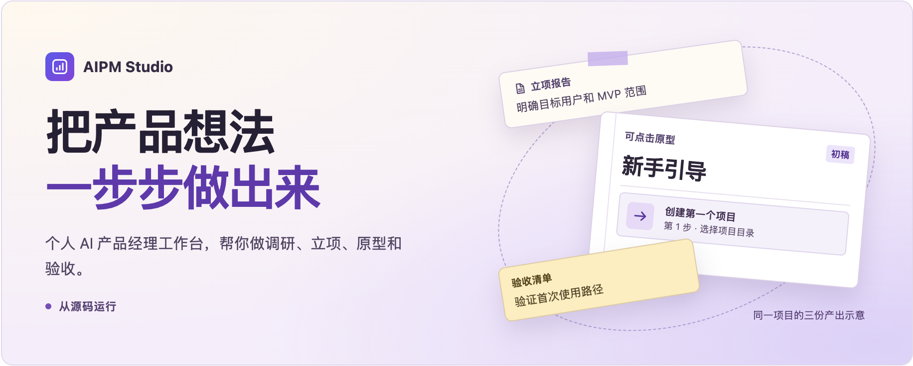
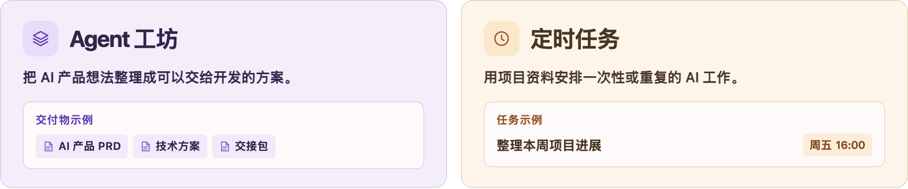

# AIPM Studio

中文 | [English](../README.md)

<picture>
  <source media="(max-width: 580px)" srcset="assets/aipm-home-zh-narrow.png">
  
</picture>

AIPM Studio 是个人 AI 产品经理工作台，应用内显示为 **Nini Flow**。打开一个项目目录，按需进入工作区。它用你已有的项目资料完成你指定的一项交付，然后等你的下一条指令。

<picture>
  <source media="(max-width: 580px)" srcset="assets/aipm-features-zh-narrow.png">
  
</picture>

<a id="agent-workshop"></a>

**Agent 工坊**可以把 AI 产品想法或已有材料整理成 PRD 和技术方案，也能从现有代码反推需求、检查实现差距、分析改动影响，或打包文档交给开发。

<a id="scheduled-tasks"></a>

**定时任务**可以安排一次性或重复的 AI 工作，也能关联已有项目。比如每周五 16:00 根据项目资料整理本周进展和待跟进事项。应用服务运行时会按计划把指令发到任务会话。

[从源码运行](#run) · [可以做什么](#example) · [桌面端](#desktop)

<a id="example"></a>

## 手上的项目，可以从哪一步开始

- **调研与立项** — 整理访谈和竞品资料，写一份明确 MVP 范围的立项报告。
- **需求与设计** — 根据已有需求，写一版 PRD，或做个能拿去评审的可点击原型。
- **开发跟进与验收** — 用已确认的范围排开发计划，或整理测试用例和验收清单。

九个工作区各自记录进度、输入材料和产出，支持按需进入。13 个内置技能覆盖立项、需求、PRD、原型、调研、任务规划和写作。上线与复盘使用通用方法。

<a id="run"></a><a id="run-from-source"></a><a id="run-from-this-repository"></a>

## 从源码运行

准备带开发头文件的 Node.js 24 或更新版本、平台原生编译器，以及 [`package.json`](../package.json) 声明的 pnpm 版本。模型调用需要你自己的提供方凭据。

```sh
git clone --branch aipm https://github.com/linliu017-art/aipm-studio-public.git
cd aipm-studio-public
pnpm install --frozen-lockfile
pnpm run build
pnpm dsh web --no-open
```

打开最后一条命令打印的本地地址，保管好其中的 token。在「设置 → 模型」中配置模型。请从本仓库构建 AIPM Studio。上游 npm 包 `@deepseek-ai/dsh` 安装的是 DeepSeek Harness。

<a id="desktop"></a>

## 桌面端

构建后运行 `pnpm run dev:desktop` 可启动 Electron 应用。本仓库目前不发布生产安装包。本地打包和签名限制见[桌面端指南](../apps/desktop/README.zh.md)。

## 隐私与安全

请人工审阅生成的决策和文档，并在授予智能体写入重要文件的权限前做好备份。模型调用和已启用的网页工具会向所选服务发送所需输入。

[隐私说明](../docs/user/privacy.zh.md) · [安全说明](../docs/user/security.zh.md) · [运行安全提示](../SAFETY.zh.md)

## 贡献与归属

AIPM Studio 由 [linliu017-art](https://github.com/linliu017-art) 独立维护，基于 [DeepSeek Harness](https://github.com/deepseek-ai/deepseek-harness) 构建，与 DeepSeek 无官方隶属或背书关系。

[问题反馈](https://github.com/linliu017-art/aipm-studio-public/issues) · [贡献指南](../CONTRIBUTING.zh.md) · [MIT 许可证](../LICENSE) · [第三方声明](../THIRD_PARTY_NOTICES.md) · [完整中文说明](../README.zh.md)
